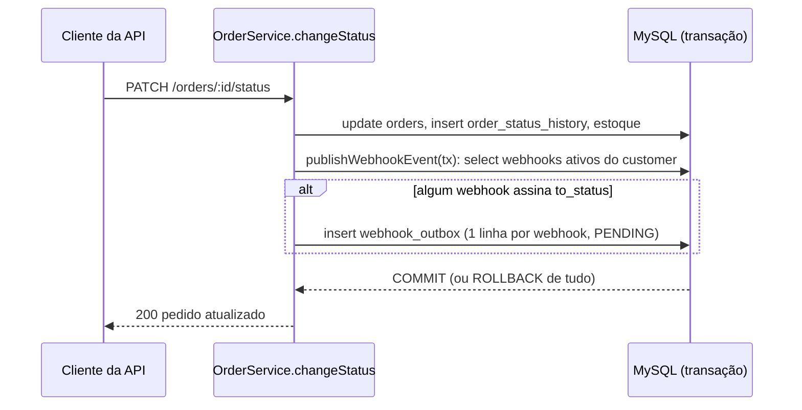

# FDD: Sistema de Webhooks de Notificação de Pedidos

Versão: 1.0
Data: 2026-11-15
Responsável: Fernando Cezar Chaves (a partir da reunião técnica conduzida por Larissa; revisão técnica prevista com Bruno e Diego, [09:50] Larissa)
Documentos relacionados: [PRD](PRD.md) · [RFC](RFC.md) · [ADRs](adrs/) · [Tracker](TRACKER.md)

> **Como ler este documento.** Os identificadores entre colchetes, como **[FDD-FLX-02]**, são as chaves do [Tracker](TRACKER.md), que liga cada item à fala da reunião (`[hh:mm] Nome`) ou ao arquivo de código de origem. Tudo que não foi decidido na reunião e é escolha de implementação está marcado como **(proposta)** e deve ser validado na sessão de revisão com Bruno e Diego ([09:50] Larissa). Os itens que dependem das questões em aberto do RFC citam a questão correspondente (Q-NN).

---

## 1. Contexto e motivação técnica

**[FDD-CTX-01]** O OMS (Node.js + TypeScript, Express, Prisma e MySQL) não tem nenhum mecanismo de notificação externa. Clientes B2B fazem polling em `GET /api/v1/orders` para descobrir mudanças de status, o que é lento e caro para eles ([09:00] Marcos).

**[FDD-CTX-02]** A mudança de status acontece em `OrderService.changeStatus` (`src/modules/orders/order.service.ts`). O método roda dentro de `prisma.$transaction` e:

- valida a transição com `canTransition` (`src/modules/orders/order.status.ts`);
- debita estoque em `PENDING → PAID` (`shouldDebitStock`) e repõe estoque em cancelamentos a partir de `PAID` ou `PROCESSING` (`shouldReplenishStock`);
- atualiza `orders` e insere em `order_status_history`.

Essa transação não pode depender da rede ([09:04] Bruno).

**[FDD-CTX-03]** A feature entrega webhooks **de saída**: um evento por mudança de status, assinado e enviado por um processo separado a partir de uma outbox transacional. As decisões que a sustentam estão em [ADR-001](adrs/ADR-001-outbox-no-mysql.md) a [ADR-007](adrs/ADR-007-snapshot-do-payload-na-insercao.md).

**Atores**

- **Usuário autenticado (`OPERATOR` ou `ADMIN`):** gerencia webhooks em nome do cliente, porque há usuários que representam o cliente ([09:32] Marcos).
- **Administrador (`ADMIN`):** faz o replay da DLQ ([09:36] Sofia).
- **Worker:** processo que entrega os eventos.
- **Endpoint do cliente:** recebe os eventos.

---

## 2. Objetivos técnicos

| ID | Objetivo | Medida ou invariante | Origem |
|---|---|---|---|
| FDD-OBJ-01 | Atomicidade entre status e evento | Para todo commit de `changeStatus` cujo novo status é assinado por algum webhook ativo do cliente, existe exatamente uma linha na outbox por webhook. Em rollback, nenhuma linha | [09:06] Diego, [09:40] Bruno |
| FDD-OBJ-02 | Latência de notificação | Do commit até o início da 1ª tentativa ≤ 2 s (intervalo de polling) mais o tempo de processamento do lote, com o objetivo de entrega bem-sucedida em < 10 s | [09:02] Marcos, [09:10] Larissa |
| FDD-OBJ-03 | Isolamento de falhas | Nenhuma chamada HTTP de webhook ocorre no processo da API nem dentro da transação de pedidos | [09:04] Bruno, [09:11] Diego |
| FDD-OBJ-04 | Retry determinístico | Os intervalos entre tentativas seguem 1 min, 5 min, 30 min, 2 h e 12 h; depois do último, o evento vai para a DLQ | [09:17] Larissa |
| FDD-OBJ-05 | Autenticidade | 100% das entregas levam `X-Signature` = HMAC-SHA256 do corpo exato enviado | [09:22] Sofia |
| FDD-OBJ-06 | Deduplicação possível | `X-Event-Id` é o mesmo em todas as tentativas e replays de um evento | [09:25] Diego |

---

## 3. Escopo e exclusões

**Incluído**

- Tabelas `webhooks`, `webhook_outbox`, `webhook_dead_letter` e `webhook_deliveries`, com migration Prisma (seção 4).
- Publicação do evento em `changeStatus` via `publishWebhookEvent(tx, order, fromStatus, toStatus)` ([09:41] Bruno).
- Worker `src/worker.ts` com o script `npm run worker` e o processador `src/modules/webhooks/webhook.processor.ts` ([09:11] Larissa, [09:28] Bruno).
- API de gestão:
  - criar e listar webhooks por cliente, editar e remover webhooks ([09:31] Marcos, [09:33] Bruno);
  - rotacionar o secret ([09:21] Sofia);
  - consultar o histórico de entregas ([09:34] Marcos);
  - fazer o replay da DLQ ([09:18] Diego).
- Assinatura HMAC-SHA256, validação de HTTPS, limite de 64 KB e timeout de 10 s ([09:22] Sofia, [09:23] Sofia, [09:24] Larissa, [09:42] Diego).

**Excluído** (fonte de cada item no [Tracker](TRACKER.md))

- **[FDD-EXC-01]** Webhooks de entrada, enviados pelo cliente ao OMS ([09:02] Marcos).
- **[FDD-EXC-02]** Notificação por e-mail de falhas repetidas: próxima fase ([09:37] Larissa).
- **[FDD-EXC-03]** Rate limiting de saída: "observar e decidir depois" ([09:39] Larissa).
- **[FDD-EXC-04]** Painel visual para o cliente: projeto separado do time de frontend ([09:40] Larissa).
- **[FDD-EXC-05]** Arquivamento das linhas entregues da outbox após cerca de 30 dias ([09:08] Diego).
- **[FDD-EXC-06]** Múltiplos workers em paralelo e ordem global ([09:13] Diego, [09:13] Larissa).
- **[FDD-EXC-07]** Itens do pedido no payload ([09:43] Diego).
- **[FDD-EXC-08]** Exactly-once ([09:25] Diego).
- **[FDD-EXC-09]** Evento na **criação** do pedido. A reunião tratou só de mudança de status (`create` em `order.service.ts` não chama `publishWebhookEvent`; ver RFC Q-10).
- **[FDD-EXC-10]** Endpoint de **listagem da DLQ**. Só o replay por id foi discutido; até haver decisão, o `id` vem do log `webhook_dead_lettered` (seção 8).

---

## 4. Modelo de dados

Todos os ids seguem o padrão do schema, `String @id @default(uuid()) @db.Char(36)` ([09:51] Larissa; `prisma/schema.prisma`). Os nomes de tabela seguem `@@map` em snake_case, como os modelos existentes.

**[FDD-DADOS-01] `webhooks`: configuração por endpoint** (URL, secret, `customer_id` e estado ativo, [09:21] Bruno, [09:21] Sofia)

| Coluna | Tipo | Observação |
|---|---|---|
| `id` | `Char(36)` | Enviado no header `X-Webhook-Id` ([09:44] Sofia) |
| `customer_id` | `Char(36)` FK → `customers.id` | Dono do webhook |
| `url` | `VarChar(2048)` | Somente `https://` ([09:23] Sofia) |
| `secret` | `VarChar(128)` | Gerado pelo OMS ([09:31] Marcos); nunca é retornado depois da criação ou da rotação |
| `previous_secret` | `VarChar(128)` nulo | Secret anterior durante a carência ([09:21] Sofia) |
| `previous_secret_expires_at` | `DateTime` nulo | Rotação + 24 h |
| `events` | `Json` | Lista de `OrderStatus` assinados ([09:33] Marcos). `Json` porque o MySQL não tem array; o projeto já usa `Json` em `Customer.address` |
| `active` | `Boolean` default `true` | Estado ativo ([09:21] Bruno) |
| `created_at`, `updated_at` | `DateTime` | Padrão dos demais modelos |

Índice: `@@index([customerId])`.

**[FDD-DADOS-02] `webhook_outbox`: um evento por webhook de destino** ([09:06] Diego)

Diego descreveu "uma linha ... com o evento" ([09:06] Diego). Gravar **uma linha por webhook de destino**, todas com o mesmo `event_id`, é **proposta** deste FDD: cada destino precisa de status, tentativas, `next_attempt_at` e histórico próprios, e o `X-Webhook-Id` diferencia os cadastros ([09:44] Sofia).

| Coluna | Tipo | Observação |
|---|---|---|
| `id` | `Char(36)` | |
| `event_id` | `Char(36)` | UUID gerado na inserção, enviado em `X-Event-Id` ([09:25] Diego). É o mesmo para todos os webhooks que recebem a mesma transição; único com `webhook_id` |
| `webhook_id` | `Char(36)` FK → `webhooks.id` `onDelete: Cascade` | |
| `order_id` | `Char(36)` | **Sem FK** para `orders`: `OrderService.delete` remove pedidos em `CANCELLED`, e uma cascade apagaria o evento de cancelamento ainda não entregue |
| `event_type` | `VarChar(64)` | `order.status_changed` ([09:43] Diego) |
| `payload` | `Json` | Snapshot renderizado na inserção ([09:52] Bruno) |
| `status` | enum `PENDING`, `PROCESSING`, `DELIVERED`, `FAILED` | Pendente, processando, entregue e falhou ([09:08] Diego) |
| `attempts` | `Int` default `0` | Tentativas já feitas |
| `next_attempt_at` | `DateTime` | Quando a próxima tentativa pode ocorrer; na inserção, o horário da inserção **(proposta)** |
| `last_error` | `VarChar(500)` nulo | Último código `WEBHOOK_*` ou mensagem |
| `created_at`, `updated_at`, `delivered_at` | `DateTime` | `delivered_at` é nulo até a entrega |

Índices:

- `@@index([status, createdAt])` ([09:08] Diego);
- `@@index([status, nextAttemptAt])` **(proposta**, para o filtro de vencidos);
- `@@index([webhookId, orderId, createdAt])` **(proposta**, para a regra de ordem do fluxo 5.2);
- `@@unique([eventId, webhookId])`.

**[FDD-DADOS-03] `webhook_dead_letter`: eventos esgotados** (payload, motivo da falha e timestamp, [09:18] Diego)

| Coluna | Tipo | Observação |
|---|---|---|
| `id` | `Char(36)` | Usado em `/admin/webhooks/dead-letter/:id/replay` |
| `outbox_id` | `Char(36)` FK → `webhook_outbox.id` `onDelete: Cascade`, `@unique` | Uma linha de DLQ por evento; uma nova falha atualiza a mesma linha |
| `webhook_id`, `event_id` | `Char(36)` | Copiados para consulta |
| `payload` | `Json` | Cópia do snapshot ([09:18] Diego) |
| `failure_reason` | `VarChar(500)` | Código `WEBHOOK_*` e detalhe ([09:18] Diego) |
| `failed_at` | `DateTime` | ([09:18] Diego) |
| `replayed_at` | `DateTime` nulo | Auditoria do replay ([09:36] Sofia) |
| `replayed_by_id` | `Char(36)` nulo FK → `users.id` | Quem fez o replay ([09:36] Sofia) |

**[FDD-DADOS-04] `webhook_deliveries`: histórico de tentativas.** Sustenta `GET /webhooks/:id/deliveries`: sucesso ou falha, payload, resposta e tempo de resposta ([09:34] Marcos).

| Coluna | Tipo | Observação |
|---|---|---|
| `id` | `Char(36)` | |
| `webhook_id` | `Char(36)` FK `onDelete: Cascade` | |
| `outbox_id` | `Char(36)` FK `onDelete: Cascade` | O payload enviado é lido daqui (snapshot) |
| `event_id` | `Char(36)` | |
| `attempt` | `Int` | 1 = envio inicial |
| `success` | `Boolean` | |
| `status_code` | `Int` nulo | Nulo em timeout ou erro de rede |
| `response_body` | `Text` nulo | Truncado em 4 KB **(proposta)** para não inflar a tabela |
| `duration_ms` | `Int` | Tempo de resposta |
| `error_code` | `VarChar(64)` nulo | `WEBHOOK_*` |
| `created_at` | `DateTime` | Índice `@@index([webhookId, createdAt])` |

---

## 5. Fluxos detalhados e diagramas

### 5.1 [FDD-FLX-01] Criação do evento na outbox (dentro de `changeStatus`)

1. `PATCH /api/v1/orders/:id/status` chega ao `OrderController.changeStatus`, que chama `OrderService.changeStatus` (código existente).
2. Dentro de `prisma.$transaction`, o código existente valida a transição, ajusta o estoque, atualiza `orders` e insere em `order_status_history`.
3. **Novo:** logo depois do `tx.orderStatusHistory.create`, `changeStatus` chama `await publishWebhookEvent(tx, order, from, to)` ([09:41] Bruno).
4. `publishWebhookEvent`:
   1. busca `tx.webhook.findMany({ where: { customerId: order.customerId, active: true } })`;
   2. mantém só os webhooks cujo `events` contém `to` (filtro na inserção, [09:34] Bruno);
   3. se a lista ficar vazia, retorna sem gravar nada ([09:34] Bruno);
   4. gera um `event_id` com `uuidv4()`, a mesma dependência `uuid` usada em `request-logger.middleware.ts`;
   5. monta o snapshot do payload (contrato 6.1) com os dados de `order` já carregados na transação ([09:52] Larissa);
   6. faz `tx.webhookOutbox.createMany` com uma linha por webhook, `status = PENDING`, `attempts = 0` e `next_attempt_at = now`.
5. Se qualquer passo lançar erro, o `$transaction` faz rollback de tudo, inclusive da mudança de status ([09:40] Bruno).



### 5.2 [FDD-FLX-02] Processamento pelo worker

**Inicialização** (`src/worker.ts`, modelado em `src/server.ts`):

1. Cria o próprio `PrismaClient` com `createPrismaClient()` (`src/config/database.ts`), na mesma `DATABASE_URL` ([09:30] Bruno).
2. **Recuperação [FDD-FLX-06] (proposta):** move para `PENDING` as linhas em `PROCESSING`, que são de um ciclo interrompido por crash. Coerente com at-least-once ([09:24] Diego).
3. Registra `SIGINT` e `SIGTERM`: termina o lote atual, desconecta o Prisma e sai, no mesmo padrão de `src/server.ts`.

**Ciclo, a cada `WEBHOOK_POLL_INTERVAL_MS` = 2000 ms** ([09:09] Diego):

1. Seleciona até `WEBHOOK_BATCH_SIZE` (10, **proposta** para o "batch pequeno" de [09:08] Diego) linhas `PENDING` com `next_attempt_at <= now()`, ordenadas por `created_at ASC` ([09:12] Diego).
2. Para cada linha, **em sequência**, porque há um único worker e a ordem importa:
   1. **Regra de ordem por pedido (proposta).** Se existe uma linha anterior (`created_at` menor) do mesmo `webhook_id` e `order_id` em `PENDING` ou `PROCESSING`, pula esta linha no ciclo. Sem essa regra, um evento em backoff seria ultrapassado pelo seguinte do mesmo pedido, e a ordem por `order_id` ([09:12] Diego) não valeria com retry. Depois que o anterior chega a `DELIVERED` ou `FAILED`, o seguinte é liberado.
   2. Marca `PROCESSING` (`updateMany ... where status = PENDING`, o que evita processar duas vezes num restart).
   3. Carrega o webhook. Se estiver inativo, segue o fluxo 5.4 com `WEBHOOK_INACTIVE` **(proposta)**.
   4. Serializa `body = JSON.stringify(payload)`. Se `Buffer.byteLength(body) > 65536`, segue o fluxo 5.4 com `WEBHOOK_PAYLOAD_TOO_LARGE`, sem retry ([09:24] Larissa; local da verificação conforme RFC Q-07).
   5. Calcula `X-Signature` = `hex(HMAC-SHA256(secret, body))` com `node:crypto` (seção 6.1).
   6. Envia `POST url` com o `fetch` nativo, `redirect: 'manual'` **(proposta**, para não seguir para um destino não validado) e `signal: AbortSignal.timeout(10000)` ([09:42] Diego).
   7. Grava a tentativa em `webhook_deliveries` (status, corpo truncado e `duration_ms`).
   8. Se a resposta for **2xx**, marca `DELIVERED` com `delivered_at = now()`.
   9. Se a resposta não for 2xx, houver timeout ou erro de rede, segue o fluxo 5.3.
3. Espera o intervalo e repete. Um ciclo que demora mais que 2 s inicia o próximo imediatamente.

### 5.3 [FDD-FLX-03] Retry com backoff exponencial

Tabela de espera depois da tentativa que falhou ([09:17] Diego, [09:17] Larissa):

| Falhou a tentativa | Próxima tentativa em | Tempo acumulado desde a 1ª falha |
|---|---|---|
| 1 (envio inicial) | +1 min | 1 min |
| 2 | +5 min | 6 min |
| 3 | +30 min | 36 min |
| 4 | +2 h | 2 h 36 min |
| 5 | +12 h | 14 h 36 min |
| 6 | sem nova tentativa: DLQ (5.4) | |

- Em caso de falha, `attempts += 1`. Se `attempts <= 5`, volta a `PENDING` com `next_attempt_at = now + RETRY_SCHEDULE[attempts - 1]` e `last_error = <código>`.
- `RETRY_SCHEDULE = [1m, 5m, 30m, 2h, 12h]` é constante no módulo; é decisão, não configuração. `MAX_ATTEMPTS = 6` reflete a leitura "1 envio + 5 retentativas" (RFC Q-01). Se a confirmação for "5 no total", basta mudar `MAX_ATTEMPTS` para 5 e encurtar a tabela, sem alterar o fluxo.
- Contam como falha: timeout de 10 s, erro de rede ou TLS, qualquer status fora de 2xx e redirecionamento 3xx ([09:42] Diego).

### 5.4 [FDD-FLX-04] Dead letter (DLQ)

Gatilhos: falha da 6ª tentativa, `WEBHOOK_PAYLOAD_TOO_LARGE` ou `WEBHOOK_INACTIVE`.

Numa única transação:

1. a linha da outbox passa a `FAILED`, com `last_error`;
2. faz `upsert` em `webhook_dead_letter` por `outbox_id`, com `payload`, `failure_reason`, `failed_at = now()`, `replayed_at = null` e `replayed_by_id = null` ([09:18] Diego).

Depois, emite o log `webhook_dead_lettered` em nível `warn` (seção 8).

### 5.5 [FDD-FLX-05] Replay manual da DLQ

1. `POST /api/v1/admin/webhooks/dead-letter/:id/replay` passa por `authenticate` e `requireRole('ADMIN')` ([09:36] Larissa).
2. Numa transação:
   1. se a DLQ não existir, retorna `WEBHOOK_DEAD_LETTER_NOT_FOUND`;
   2. se a linha da outbox não estiver `FAILED` (por exemplo, por um replay anterior ainda pendente), retorna `WEBHOOK_REPLAY_ALREADY_PENDING` **(proposta)**;
   3. a **mesma linha** da outbox volta a `PENDING`, com `attempts = 0`, `next_attempt_at = now()` e `last_error = null`. O `event_id` não muda, então o cliente recebe o mesmo `X-Event-Id` e consegue deduplicar ([09:25] Diego). Isso é **proposta**: a leitura literal de "recoloca na outbox" ([09:18] Diego) poderia gerar um id novo (RFC Q-11);
   4. a DLQ recebe `replayed_at = now()` e `replayed_by_id = req.user.id`.
3. Emite o log de auditoria `webhook_dead_letter_replayed` com `adminUserId`, `deadLetterId`, `eventId` e `webhookId` ([09:36] Sofia).

### 5.6 [FDD-FLX-07] Rotação de secret

`POST /api/v1/webhooks/:id/rotate-secret`:

1. `previous_secret = secret`;
2. `previous_secret_expires_at = now + 24 h`;
3. `secret = randomBytes(32).toString('hex')`.

O novo secret é retornado uma única vez ([09:21] Sofia). Uma nova rotação durante a carência substitui o `previous_secret`.

**Assinatura durante a carência (proposta, pendente de Q-03 e da revisão da Sofia):** enquanto `previous_secret_expires_at > now`, o `X-Signature` leva as duas assinaturas separadas por vírgula, com a do secret novo primeiro. Assim o cliente valida com qualquer um dos dois, que é o que "a antiga fica válida por 24 horas em paralelo" ([09:21] Sofia) exige de um webhook de saída.

---

## 6. Contratos públicos

Todos os endpoints de gestão ficam sob `/api/v1`, como montado em `src/app.ts`, e exigem `Authorization: Bearer <JWT>` (`authenticate`). Os erros saem no envelope do `errorMiddleware`: `{ "error": { "code", "message", "details"? } }`.

### 6.1 [FDD-CONTRATO-01] Entrega ao cliente (OMS → endpoint do cliente)

- **Tipo:** requisição HTTP de saída
- **Método e destino:** `POST <webhook.url>` (somente `https`)
- **Timeout:** 10 s ([09:42] Diego)
- **Tamanho máximo do corpo:** 64 KB ([09:24] Larissa)

| Header | Semântica | Origem |
|---|---|---|
| `Content-Type: application/json` | Corpo JSON | [09:44] Diego |
| `X-Event-Id` | UUID do evento, estável entre tentativas e replays; chave de deduplicação | [09:25] Diego |
| `X-Signature` | `hex(HMAC-SHA256(secret, corpo bruto))`; na carência, `<novo>,<anterior>` (5.6) | [09:20] Sofia, [09:22] Sofia |
| `X-Timestamp` | Instante **do envio** desta tentativa, em ISO 8601 UTC **(proposta** de formato); permite ao cliente detectar replay | [09:44] Diego |
| `X-Webhook-Id` | `id` do cadastro de webhook que originou o envio | [09:44] Sofia, [09:45] Diego |

**Exemplo de requisição (corpo)** ([09:43] Diego)

```json
{
  "event_id": "7f1c2a4e-0d3b-4c5e-9a8f-1b2c3d4e5f60",
  "event_type": "order.status_changed",
  "timestamp": "2026-11-20T14:03:12.000Z",
  "order_id": "3b0e8c52-9a4f-4f1e-8d2b-6c7a1e2f3d40",
  "order_number": "ORD-000123",
  "from_status": "PAID",
  "to_status": "PROCESSING",
  "customer_id": "c1a2b3c4-d5e6-4f70-8a9b-0c1d2e3f4a5b",
  "total_cents": 45000
}
```

- `timestamp` é o instante da mudança de status (snapshot); `X-Timestamp` é o instante do envio.
- `order_number` segue o formato `ORD-NNNNNN` de `reserveOrderNumber`.
- Os itens não são enviados ([09:43] Diego).

**Resposta esperada do cliente:** qualquer `2xx` confirma a entrega, e o corpo é ignorado (só é guardado truncado no histórico). Qualquer outro status, timeout ou erro de rede aciona o retry (5.3).

**Verificação pelo cliente** (para o portal do desenvolvedor, [09:26] Marcos):

```ts
const expected = createHmac('sha256', secret).update(rawBody).digest('hex');
const ok = header.split(',').some((sig) => timingSafeEqual(Buffer.from(sig), Buffer.from(expected)));
```

### 6.2 [FDD-CONTRATO-02] `POST /api/v1/customers/:customerId/webhooks`: criar webhook

Qualquer usuário autenticado ([09:37] Sofia). O `customerId` vem do **path** e não do JWT. Larissa admitiu body ou path ([09:32] Larissa); a escolha do path é **proposta** (Q-02), para que criação e listagem usem o mesmo recurso.

**Requisição**

```json
{
  "url": "https://hooks.atlascomercial.com.br/oms",
  "events": ["SHIPPED", "DELIVERED"]
}
```

**Resposta `201 Created`.** O `secret` aparece **somente aqui** e na rotação ([09:31] Marcos).

```json
{
  "id": "9d8c7b6a-5f4e-4d3c-8b2a-1f0e9d8c7b6a",
  "customerId": "c1a2b3c4-d5e6-4f70-8a9b-0c1d2e3f4a5b",
  "url": "https://hooks.atlascomercial.com.br/oms",
  "events": ["SHIPPED", "DELIVERED"],
  "active": true,
  "secret": "3f9a1c0e7b2d4e6f8a1b3c5d7e9f0a2b4c6d8e0f1a3b5c7d9e1f2a4b6c8d0e2f",
  "createdAt": "2026-11-20T13:00:00.000Z",
  "updatedAt": "2026-11-20T13:00:00.000Z"
}
```

| Status | Quando |
|---|---|
| 201 | Criado |
| 400 `VALIDATION_ERROR` | Body inválido: URL não `https` (detalhe `WEBHOOK_INVALID_URL`), `events` vazio ou com valor fora de `OrderStatus`; ou `customerId` do path não é UUID |
| 401 `UNAUTHORIZED` | Sem token ou token inválido |
| 404 `WEBHOOK_CUSTOMER_NOT_FOUND` | `customerId` inexistente |

### 6.3 [FDD-CONTRATO-03] `GET /api/v1/customers/:customerId/webhooks?page=1&pageSize=20`: listar webhooks de um cliente

Lista os webhooks de um cliente ([09:33] Bruno). O `customerId` vai no path, como em 6.2 (Q-02). A paginação segue `paginated` (`src/shared/http/response.ts`) e o padrão de `page` e `pageSize` de `listOrdersQuerySchema`. O `secret` nunca é retornado.

**Resposta `200 OK`**

```json
{
  "data": [
    {
      "id": "9d8c7b6a-5f4e-4d3c-8b2a-1f0e9d8c7b6a",
      "customerId": "c1a2b3c4-d5e6-4f70-8a9b-0c1d2e3f4a5b",
      "url": "https://hooks.atlascomercial.com.br/oms",
      "events": ["SHIPPED", "DELIVERED"],
      "active": true,
      "previousSecretExpiresAt": null,
      "createdAt": "2026-11-20T13:00:00.000Z",
      "updatedAt": "2026-11-20T13:00:00.000Z"
    }
  ],
  "pagination": { "page": 1, "pageSize": 20, "total": 1, "totalPages": 1 }
}
```

| Status | Quando |
|---|---|
| 200 | Sucesso, inclusive lista vazia |
| 400 `VALIDATION_ERROR` | `customerId` não UUID, ou `page`/`pageSize` inválidos |
| 401 `UNAUTHORIZED` | Sem token |
| 404 `WEBHOOK_CUSTOMER_NOT_FOUND` | `customerId` inexistente |

### 6.4 [FDD-CONTRATO-04] `PATCH /api/v1/webhooks/:id`: editar webhook

Edita o webhook ([09:33] Bruno). Campos opcionais: `url`, `events` e `active` ([09:21] Bruno). O secret **não** é editável por aqui; existe a rotação para isso.

**Requisição**

```json
{ "events": ["PROCESSING", "SHIPPED", "DELIVERED"], "active": true }
```

**Resposta `200 OK`:** o webhook atualizado, no formato de 6.3, sem `secret`.

| Status | Quando |
|---|---|
| 200 | Atualizado |
| 400 `VALIDATION_ERROR` | Body inválido ou vazio, ou URL não `https` (detalhe `WEBHOOK_INVALID_URL`) |
| 401 `UNAUTHORIZED` | Sem token |
| 404 `WEBHOOK_NOT_FOUND` | `id` inexistente |

Semântica: mudar `events` vale para as **próximas** mudanças de status, porque o filtro é aplicado na inserção ([09:34] Bruno). Os eventos já na outbox não são afetados.

### 6.5 [FDD-CONTRATO-05] `DELETE /api/v1/webhooks/:id`: remover webhook

Remove o webhook ([09:33] Bruno). **Resposta `204 No Content`.** `404 WEBHOOK_NOT_FOUND` se o `id` não existir; `401` sem token.

Semântica: remoção física com `onDelete: Cascade` na outbox, no histórico e na DLQ daquele webhook, seguindo o padrão de cascade de `OrderItem` no schema **(proposta)**. Eventos pendentes daquele destino deixam de ser entregues. Para pausar sem perder o histórico, usa-se `PATCH { "active": false }`.

### 6.6 [FDD-CONTRATO-06] `POST /api/v1/webhooks/:id/rotate-secret`: rotacionar secret

Rotaciona o secret ([09:21] Sofia). A requisição não tem corpo. O caminho do endpoint é **proposta**; a reunião definiu só a capacidade.

**Resposta `200 OK`**

```json
{
  "id": "9d8c7b6a-5f4e-4d3c-8b2a-1f0e9d8c7b6a",
  "secret": "a7c9e1f3b5d7092b4d6f8a0c2e4b6d8f0a2c4e6b8d0f2a4c6e8b0d2f4a6c8e0b",
  "previousSecretExpiresAt": "2026-11-21T13:00:00.000Z"
}
```

| Status | Quando |
|---|---|
| 200 | Rotacionado; o secret anterior vale até `previousSecretExpiresAt` (24 h) |
| 401 `UNAUTHORIZED` | Sem token |
| 404 `WEBHOOK_NOT_FOUND` | `id` inexistente |

### 6.7 [FDD-CONTRATO-07] `GET /api/v1/webhooks/:id/deliveries`: histórico de entregas

Retorna as **últimas 100** tentativas, da mais recente para a mais antiga, com sucesso ou falha, payload, resposta e tempo de resposta ([09:34] Marcos).

**Resposta `200 OK`**

```json
{
  "data": [
    {
      "id": "e0d1c2b3-a4f5-4e6d-8c7b-9a0f1e2d3c4b",
      "eventId": "7f1c2a4e-0d3b-4c5e-9a8f-1b2c3d4e5f60",
      "attempt": 2,
      "success": true,
      "statusCode": 200,
      "durationMs": 184,
      "errorCode": null,
      "payload": { "event_id": "7f1c2a4e-0d3b-4c5e-9a8f-1b2c3d4e5f60", "event_type": "order.status_changed", "to_status": "PROCESSING" },
      "responseBody": "{\"received\":true}",
      "createdAt": "2026-11-20T14:04:13.000Z"
    },
    {
      "id": "b9a8f7e6-d5c4-4b3a-9f8e-7d6c5b4a3f2e",
      "eventId": "7f1c2a4e-0d3b-4c5e-9a8f-1b2c3d4e5f60",
      "attempt": 1,
      "success": false,
      "statusCode": null,
      "durationMs": 10000,
      "errorCode": "WEBHOOK_DELIVERY_TIMEOUT",
      "payload": { "event_id": "7f1c2a4e-0d3b-4c5e-9a8f-1b2c3d4e5f60", "event_type": "order.status_changed", "to_status": "PROCESSING" },
      "responseBody": null,
      "createdAt": "2026-11-20T14:03:13.000Z"
    }
  ]
}
```

O `payload` aparece abreviado no exemplo; na resposta real é o snapshot completo da outbox.

| Status | Quando |
|---|---|
| 200 | Sucesso, inclusive lista vazia |
| 401 `UNAUTHORIZED` | Sem token |
| 404 `WEBHOOK_NOT_FOUND` | `id` inexistente |

### 6.8 [FDD-CONTRATO-08] `POST /api/v1/admin/webhooks/dead-letter/:id/replay`: replay da DLQ

Exige role **`ADMIN`** ([09:18] Diego, [09:36] Sofia). A requisição não tem corpo.

**Resposta `202 Accepted`.** O evento volta à fila, e a entrega acontece de forma assíncrona.

```json
{
  "deadLetterId": "5c4b3a29-1807-4f6e-9d5c-4b3a29180700",
  "eventId": "7f1c2a4e-0d3b-4c5e-9a8f-1b2c3d4e5f60",
  "webhookId": "9d8c7b6a-5f4e-4d3c-8b2a-1f0e9d8c7b6a",
  "status": "PENDING",
  "replayedAt": "2026-11-21T09:15:00.000Z",
  "replayedById": "0a1b2c3d-4e5f-4a6b-8c7d-9e0f1a2b3c4d"
}
```

| Status | Quando |
|---|---|
| 202 | Evento recolocado como pendente |
| 401 `UNAUTHORIZED` | Sem token |
| 403 `FORBIDDEN` | Usuário sem role `ADMIN` (código emitido pelo `requireRole` existente) |
| 404 `WEBHOOK_DEAD_LETTER_NOT_FOUND` | `id` inexistente |
| 409 `WEBHOOK_REPLAY_ALREADY_PENDING` | O evento já foi recolocado e ainda não terminou |

### 6.9 [FDD-CONTRATO-09] Função interna `publishWebhookEvent`

```ts
// src/modules/webhooks/webhook.publisher.ts
export async function publishWebhookEvent(
  tx: Prisma.TransactionClient,
  order: Pick<Order, 'id' | 'orderNumber' | 'customerId' | 'totalCents'>,
  fromStatus: OrderStatus,
  toStatus: OrderStatus,
): Promise<void>;
```

Assinatura acordada em [09:41] Bruno. É uma função pura que recebe o `tx`, sem repository injetado ([09:41] Diego). Ela não captura erro: qualquer falha propaga e provoca o rollback de `changeStatus` ([09:40] Bruno).

---

## 7. Erros, exceções e fallback

### 7.1 Matriz de erros

As classes ficam em `src/modules/webhooks/webhook.errors.ts` e estendem `AppError` (`src/shared/errors/app-error.ts`) ou as subclasses que aceitam código ([09:28] Bruno, [09:29] Larissa). Erros de API são serializados pelo `errorMiddleware` sem alteração ([09:29] Bruno). Erros de entrega não chegam a nenhuma resposta HTTP: ficam em `webhook_deliveries.error_code`, `webhook_outbox.last_error` e `webhook_dead_letter.failure_reason`.

**Origem dos nomes.** Só `WEBHOOK_NOT_FOUND` e `WEBHOOK_INVALID_URL` foram citados literalmente ([09:28] Bruno). Os demais nomes são **propostas** que seguem o prefixo decidido ([09:29] Larissa). A **condição** de cada um vem da fala indicada na coluna Origem.

| ID | Código | HTTP | Condição | Tratamento | Origem |
|---|---|---|---|---|---|
| FDD-ERR-01 | `WEBHOOK_NOT_FOUND` | 404 | `id` de webhook inexistente em PATCH, DELETE, rotação ou deliveries | `class WebhookNotFoundError extends AppError(…, 404, 'WEBHOOK_NOT_FOUND')`. Não estende `NotFoundError`, que fixa `NOT_FOUND` | [09:28] Bruno |
| FDD-ERR-02 | `WEBHOOK_INVALID_URL` | 400 | URL sem `https` | Regra `refine` no schema Zod ([09:23] Sofia) com a mensagem `WEBHOOK_INVALID_URL: url must use https`. O `validate` responde `VALIDATION_ERROR`, com o código em `details[].message` (seção 9) | [09:23] Sofia, [09:28] Bruno |
| FDD-ERR-03 | `WEBHOOK_CUSTOMER_NOT_FOUND` | 404 | `customerId` inexistente na criação | `AppError(…, 404, 'WEBHOOK_CUSTOMER_NOT_FOUND')` | [09:29] Larissa (prefixo para tudo do módulo) |
| FDD-ERR-04 | `WEBHOOK_DEAD_LETTER_NOT_FOUND` | 404 | `id` de DLQ inexistente no replay | `AppError(…, 404, …)` | [09:18] Diego |
| FDD-ERR-05 | `WEBHOOK_REPLAY_ALREADY_PENDING` | 409 | Replay de evento cuja outbox não está `FAILED` | `ConflictError(msg, 'WEBHOOK_REPLAY_ALREADY_PENDING')` **(proposta)** | [09:18] Diego |
| FDD-ERR-06 | `WEBHOOK_DELIVERY_TIMEOUT` | n/a | O cliente não respondeu em 10 s | Falha → retry (5.3) | [09:42] Diego |
| FDD-ERR-07 | `WEBHOOK_DELIVERY_FAILED` | n/a | Status fora de 2xx, 3xx ou erro de rede ou TLS | Falha → retry (5.3); `status_code` registrado | [09:15] Diego |
| FDD-ERR-08 | `WEBHOOK_MAX_ATTEMPTS_EXCEEDED` | n/a | A 6ª tentativa falhou | Vai para a DLQ (5.4); `failure_reason` leva também o último erro | [09:15] Diego, [09:17] Larissa |
| FDD-ERR-09 | `WEBHOOK_PAYLOAD_TOO_LARGE` | n/a | Corpo > 64 KB | Vai direto para a DLQ, sem retry: "erra", não trunca | [09:23] Sofia, [09:24] Larissa |
| FDD-ERR-10 | `WEBHOOK_INACTIVE` | n/a | Webhook desativado com evento ainda pendente | Vai para a DLQ, de onde pode ser reprocessado após reativação **(proposta)** | [09:21] Bruno |

**[FDD-ERR-11] Códigos não usados.** `WEBHOOK_SECRET_REQUIRED` foi citado como exemplo ([09:28] Bruno), mas o secret é sempre gerado pelo OMS ([09:31] Marcos), e não há condição em que ele falte. O código não entra na matriz para não criar um erro sem gatilho.

Erros já existentes, mantidos sem prefixo porque vêm de middlewares compartilhados:

- `UNAUTHORIZED` (401) e `FORBIDDEN` (403), emitidos por `auth.middleware.ts`;
- `VALIDATION_ERROR` (400), emitido por `validate.middleware.ts`.

### 7.2 Estratégias de resiliência

| ID | Estratégia | Valor | Origem |
|---|---|---|---|
| FDD-RES-01 | Timeout por chamada | 10 s (`AbortSignal.timeout`) | [09:42] Diego |
| FDD-RES-02 | Retries | 5 retentativas após o envio inicial (Q-01) | [09:15] Diego, [09:17] Larissa |
| FDD-RES-03 | Backoff | Exponencial com tabela fixa: 1m, 5m, 30m, 2h, 12h | [09:17] Diego |
| FDD-RES-04 | Fila de falhas | `webhook_dead_letter` + replay `ADMIN` | [09:18] Diego |
| FDD-RES-05 | Circuit breaker | Não adotado **(proposta: o tema não foi discutido)**; o backoff por evento e a DLQ cumprem o papel. Rate limiting por cliente é questão em aberto | [09:39] Larissa |

### 7.3 Política de fallback

- **Cliente fora do ar:** o evento fica na outbox com backoff por até cerca de 14 h 36 min e depois vai para a DLQ. Não há canal alternativo, porque o e-mail ficou para a próxima fase ([09:37] Larissa).
- **Worker parado:** os eventos se acumulam em `PENDING` sem perda. Ao voltar, o worker os processa por ordem de `created_at` ([09:12] Diego).
- **Banco indisponível:** `changeStatus` falha como hoje, e o ciclo do worker loga o erro e tenta de novo no próximo intervalo.

### 7.4 Invariantes

1. **[FDD-INV-01]** Não existe mudança de status confirmada sem a linha de outbox correspondente, quando algum webhook assina o status ([09:40] Bruno).
2. **[FDD-INV-02]** O `event_id` de um evento nunca muda, nem em retry nem em replay ([09:25] Diego).
3. **[FDD-INV-03]** Os bytes assinados são exatamente os bytes enviados ([09:22] Sofia).
4. **[FDD-INV-04]** Nenhuma chamada de rede acontece dentro de `prisma.$transaction` ([09:04] Bruno).
5. **[FDD-INV-05]** O secret nunca aparece em log nem em resposta depois da criação ou da rotação. Invariante derivada: o secret é "devolvido na criação" ([09:31] Marcos), e vazamento de secret em log já causou incidente ([09:22] Diego).

---

## 8. Observabilidade

O projeto tem apenas o logger Pino (`src/shared/logger/index.ts`) e não tem biblioteca de métricas nem de tracing (`package.json`). Seguindo o ADR-006 ("Não vamos botar nada novo", [09:29] Bruno), a observabilidade inicial usa **logs estruturados** e **consultas às tabelas do módulo**.

### Logs [FDD-OBS-01]

O worker usa `logger.child({ component: 'webhook-worker' })`. Os campos comuns são `eventId`, `webhookId`, `orderId` e `outboxId`. Os nomes de evento seguem o estilo snake_case dos logs existentes (`server_started`, `http_request`).

| Evento | Nível | Campos adicionais |
|---|---|---|
| `webhook_worker_started` / `webhook_worker_stopped` | info | `pollIntervalMs`, `batchSize`, `signal` |
| `webhook_delivery_attempt` | info | `attempt`, `statusCode`, `durationMs`, `outcome` (`delivered`, `retry` ou `dead_letter`), `errorCode` |
| `webhook_delivery_retry_scheduled` | info | `attempt`, `nextAttemptAt` |
| `webhook_dead_lettered` | warn | `deadLetterId`, `failureReason` |
| `webhook_dead_letter_replayed` | info | `deadLetterId`, `adminUserId`: auditoria do replay ([09:36] Sofia) |
| `webhook_secret_rotated` | info | `userId` (nunca o secret) |
| `webhook_worker_cycle` | debug | `picked`, `durationMs` |
| `webhook_worker_heartbeat` (a cada 30 ciclos, cerca de 1 min, **proposta**) | info | `pendingCount`, `oldestPendingAgeMs`, `deadLetterOpenCount` |

Proteção de dados: acrescentar `'*.secret'` e `'*.previousSecret'` aos `redactPaths` do logger. O `requestLogger` (`request-logger.middleware.ts`) registra só metadados da requisição, então o secret devolvido no `201` não vai para o log.

### Métricas [FDD-OBS-02]

As métricas são derivadas das tabelas e do heartbeat. Não há endpoint de métricas.

| Métrica | Como obter | Uso |
|---|---|---|
| Backlog pendente | `COUNT(*) FROM webhook_outbox WHERE status = 'PENDING'` | Saturação do worker |
| Idade do pendente mais antigo | `NOW() - MIN(created_at) WHERE status = 'PENDING' AND attempts = 0` | **Indicador da meta de < 10 s** ([09:02] Marcos) |
| Latência até a 1ª entrega | `webhook_deliveries.created_at` (com `attempt = 1`) − `webhook_outbox.created_at` | p50/p95 contra a meta de 10 s |
| Taxa de sucesso | `AVG(success)` em `webhook_deliveries`, por `webhook_id` e por dia | Saúde por cliente |
| DLQ aberta | `COUNT(*) FROM webhook_dead_letter WHERE replayed_at IS NULL` | Eventos que exigem ação |
| Tentativas por evento | Distribuição de `attempts` em `DELIVERED` | Instabilidade dos clientes |

### Tracing [FDD-OBS-03]

Não há tracing distribuído no projeto; a rastreabilidade é feita por **ids de correlação nos logs**:

1. A requisição `PATCH /orders/:id/status` gera `requestId` (`X-Request-Id`), e o log `http_request` inclui o `path` com o id do pedido.
2. O `orderId` liga essa requisição à linha da outbox, que tem `eventId`.
3. O `eventId` liga todas as tentativas (`webhook_delivery_attempt`) e o histórico.
4. O cliente recebe o mesmo valor em `X-Event-Id`, o que permite correlação ponta a ponta com os logs dele.

A introdução de OpenTelemetry exigiria uma dependência nova e fica fora desta entrega (ADR-006).

### Dashboards e alertas [FDD-OBS-04] (proposta)

| Alerta | Condição |
|---|---|
| Atraso de entrega | `oldestPendingAgeMs` > 10 000 por 5 minutos |
| Worker parado | Nenhum `webhook_worker_heartbeat` há mais de 2 minutos |
| Nova DLQ | Qualquer `webhook_dead_lettered`, notificado ao time de Pedidos |

---

## 9. Integração com o sistema existente

| ID | Arquivo | Como o módulo de webhooks se integra |
|---|---|---|
| FDD-INT-01 | `src/modules/orders/order.service.ts` | **Ponto crítico** ([09:40] Bruno). Em `changeStatus`, depois de `await tx.orderStatusHistory.create(...)` e antes de recarregar o pedido (`refreshed`), acrescentar `await publishWebhookEvent(tx, order, from, to)`. O `order` já está carregado (`tx.order.findUnique`) com `id`, `orderNumber`, `customerId` e `totalCents`; `from` e `to` já existem como variáveis locais. O tipo `TxClient = Prisma.TransactionClient` já declarado no arquivo é o tipo do parâmetro `tx`. Nenhum outro método muda: `create` e `delete` ficam como estão (RFC Q-10). |
| FDD-INT-02 | `src/modules/orders/order.status.ts` | Não muda. Os valores aceitos em `events` são o enum `OrderStatus` usado por `transitions`. Como o filtro é por `to_status`, `PENDING` nunca é emitido: nenhuma transição termina em `PENDING`, e a criação não emite evento. A validação aceita o enum completo por simplicidade. |
| FDD-INT-03 | `src/shared/errors/app-error.ts` e `src/shared/errors/http-errors.ts` | Os novos erros (7.1) estendem `AppError` para códigos 404 próprios, porque `NotFoundError(resource)` fixa `'NOT_FOUND'` e não aceita código, e estendem `ConflictError(message, code)` para 409. `src/shared/errors/index.ts` não muda; as classes ficam em `src/modules/webhooks/webhook.errors.ts`. |
| FDD-INT-04 | `src/middlewares/error.middleware.ts` | **Nenhuma alteração** ([09:29] Bruno). O ramo `err instanceof AppError` já serializa `code`, `message` e `details`. Os ramos `P2002` e `P2025` cobrem conflitos e registros ausentes do Prisma no módulo novo. |
| FDD-INT-05 | `src/middlewares/validate.middleware.ts` | Os schemas do módulo (`webhook.schemas.ts`) passam por `validate({ body, params, query })`. Como o middleware converte todo `ZodError` em `ValidationError` (`VALIDATION_ERROR`), a regra de HTTPS usa a mensagem `WEBHOOK_INVALID_URL: url must use https`, e o código do módulo aparece em `details[].message` sem mudar o middleware compartilhado. |
| FDD-INT-06 | `src/middlewares/auth.middleware.ts` | O router `/webhooks` aplica `router.use(authenticate)`, como `order.routes.ts`, e aceita qualquer role ([09:37] Sofia). O router `/admin/webhooks` aplica `authenticate` e `requireRole('ADMIN')` ([09:36] Larissa). `req.user.id` alimenta `replayed_by_id` e o log de auditoria. |
| FDD-INT-07 | `src/routes/index.ts` e `src/app.ts` | Em `Controllers`, acrescentar `webhooks: WebhookController` e `adminWebhooks: AdminWebhookController`. Em `buildApiRouter`, adicionar:<br>• `router.use('/customers/:customerId/webhooks', buildCustomerWebhookRouter(...))`, **antes** de `router.use('/customers', ...)`, com `Router({ mergeParams: true })` para ler `customerId` (6.2 e 6.3);<br>• `router.use('/webhooks', buildWebhookRouter(...))` para as operações por id;<br>• `router.use('/admin/webhooks', buildAdminWebhookRouter(...))`.<br>O `customer.routes.ts` não muda. Em `buildControllers` (`src/app.ts`), instanciar `WebhookRepository(prisma)`, `WebhookService` e os controllers, no mesmo padrão dos outros domínios. |
| FDD-INT-08 | `src/server.ts` | Modelo para o novo `src/worker.ts`: `bootstrap()` assíncrono, `logger.info(..., 'webhook_worker_started')` e encerramento em `SIGINT`/`SIGTERM` com `prisma.$disconnect()`, sem servidor HTTP ([09:11] Larissa). |
| FDD-INT-09 | `src/config/database.ts` | O worker chama `createPrismaClient()` para ter a própria instância ([09:30] Bruno), com a mesma `DATABASE_URL`. |
| FDD-INT-10 | `src/config/env.ts` | Acrescentar ao `envSchema` as variáveis `WEBHOOK_POLL_INTERVAL_MS` (default 2000), `WEBHOOK_HTTP_TIMEOUT_MS` (default 10000) e `WEBHOOK_BATCH_SIZE` (default 10), validadas como as demais, com `z.coerce.number().int().positive()`. Os dois primeiros defaults vêm de [09:09] Diego e [09:42] Diego. |
| FDD-INT-11 | `src/shared/logger/index.ts` | Reuso do `logger` (Pino) ([09:29] Bruno). Acrescentar `'*.secret'` e `'*.previousSecret'` a `redactPaths` ([09:22] Diego). |
| FDD-INT-12 | `prisma/schema.prisma` | Novos modelos (seção 4), novo enum `WebhookOutboxStatus`, relação `Customer.webhooks` e relação de `User` com `WebhookDeadLetter.replayedBy`. Migration via `npm run db:migrate`, que é `prisma migrate dev`. |
| FDD-INT-13 | `package.json` | Novo script `"worker": "tsx --env-file=.env src/worker.ts"` para desenvolvimento, no padrão de `dev`, e o build gera `dist/worker.js` (via `tsconfig.build.json`) para produção. Nenhuma dependência nova: `node:crypto`, o `fetch` nativo (`engines.node >= 20`) e o `uuid` já presente. |
| FDD-INT-14 | `src/shared/http/response.ts` | `paginated(...)` na listagem de webhooks (6.3), com a mesma forma `{ data, pagination }` das outras listagens. |
| FDD-INT-15 | `tests/setup.ts` e `tests/helpers/factories.ts` | No `beforeEach`, apagar `webhookDelivery`, `webhookDeadLetter`, `webhookOutbox` e `webhook` antes de `order` e `customer`, respeitando as FKs. Nos testes de replay, `bootstrapAuthenticatedUser('ADMIN')`. |

**Limitação herdada do código [FDD-INT-16].** `prisma/schema.prisma` não relaciona `User` a `Customer`: o JWT (`auth.middleware.ts`) traz só `id`, `email` e `role`. Por isso não é possível restringir um usuário aos webhooks "do seu" cliente. Isso é coerente com "por enquanto qualquer role autenticada" ([09:37] Sofia) e está registrado como RFC Q-06.

---

## 10. Dependências e compatibilidade

| Componente | Versão mínima | Observações |
|---|---|---|
| Node.js | 20 | `engines` em `package.json`; necessário para o `fetch` nativo e `AbortSignal.timeout` |
| MySQL | 8.0 | `docker-compose.yml`; tipo `Json` e índices compostos |
| Prisma / `@prisma/client` | 5.22.0 | Versão fixada em `package.json`; `$transaction` interativo e `createMany` |
| Express | 4.21.1 | Routers do módulo |
| Zod | 3.23.8 | Schemas e `refine` para HTTPS |
| Pino | 9.5.0 | Logger e `child` |
| uuid | 11.0.3 | `event_id` |

**Garantias de compatibilidade**

- **[FDD-COMP-01]** Nenhuma rota existente muda de contrato. `PATCH /orders/:id/status` mantém request e response; só ganha a gravação na outbox.
- **[FDD-COMP-02]** O payload do evento é versionado por `event_type`. Uma mudança incompatível deve criar outro tipo, e não alterar `order.status_changed`, porque os clientes integram contra ele pelo portal ([09:26] Marcos) **(proposta)**.
- **[FDD-COMP-03]** Clientes sem webhook cadastrado não geram nenhuma linha nova; o comportamento do OMS para eles é idêntico ao atual ([09:34] Bruno).

---

## 11. Riscos e mitigação

### [FDD-RISK-01] Cliente processa o mesmo evento duas vezes

- **Probabilidade:** média (timeouts e replays geram reenvio)
- **Impacto:** médio (ação duplicada do lado do cliente)
- **Mitigação:**
  - `X-Event-Id` estável (FDD-INV-02) ([09:25] Diego)
  - Documentação destacada no portal do desenvolvedor ([09:26] Marcos)
- **Plano de contingência:** o histórico de entregas mostra as tentativas por `eventId` para conciliação com o cliente.

### [FDD-RISK-02] Worker único parado ou lento

- **Probabilidade:** baixa
- **Impacto:** alto (todas as notificações atrasam; nenhuma se perde)
- **Mitigação:**
  - Processo separado da API ([09:11] Diego)
  - Alertas de heartbeat e de idade do pendente (seção 8)
- **Plano de contingência:** reiniciar o worker; o backlog é processado em ordem. Escalar para vários workers depende da decisão de Q-05 ([09:13] Diego).

### [FDD-RISK-03] Vazamento de secret pelo cliente

- **Probabilidade:** média (já aconteceu, [09:22] Diego)
- **Impacto:** médio (terceiros podem forjar eventos para aquele endpoint)
- **Mitigação:**
  - Secret por endpoint ([09:21] Sofia)
  - Rotação self-service com carência de 24 h ([09:21] Sofia)
  - `redact` no logger (FDD-INV-05)
- **Plano de contingência:** rotação imediata; depois das 24 h o secret antigo deixa de valer.

### [FDD-RISK-04] Replay de requisições capturadas

- **Probabilidade:** baixa
- **Impacto:** médio
- **Mitigação:**
  - TLS obrigatório ([09:23] Sofia)
  - `X-Timestamp` disponível ao cliente ([09:44] Diego)
- **Plano de contingência:** o `X-Timestamp` não é coberto pela assinatura, que é só sobre o corpo ([09:22] Sofia). Incluí-lo na assinatura é ponto para a revisão de segurança ([09:46] Sofia).

### [FDD-RISK-05] Rajada de eventos para um mesmo cliente

- **Probabilidade:** média
- **Impacto:** médio (cliente sobrecarregado; falhas viram retries)
- **Mitigação:**
  - Lote pequeno e worker sequencial limitam a taxa natural de envio
  - Monitorar a taxa de falha por webhook (seção 8)
- **Plano de contingência:** rate limiting de saída, se virar problema ([09:39] Larissa, Q-04).

### [FDD-RISK-06] Bloqueio da fila de um pedido pela regra de ordem

- **Probabilidade:** baixa
- **Impacto:** baixo (eventos do mesmo pedido e webhook esperam o anterior, até cerca de 14 h 36 min no pior caso)
- **Mitigação:**
  - A regra vale só por par `webhook_id` e `order_id`; os demais pedidos não são afetados
  - Ao chegar à DLQ, o anterior libera os seguintes
- **Plano de contingência:** se a espera se mostrar indesejada, remover a regra e aceitar a reordenação sob retry. Essa decisão depende da revisão com Diego ([09:12] Diego).

### [FDD-RISK-07] Crescimento da `webhook_outbox` e de `webhook_deliveries`

- **Probabilidade:** alta no médio prazo
- **Impacto:** baixo no início (índices em status e `created_at`)
- **Mitigação:**
  - Índices definidos na seção 4 ([09:08] Diego)
  - Leitura do histórico limitada a 100 itens ([09:34] Marcos)
- **Plano de contingência:** arquivamento após cerca de 30 dias numa feature futura ([09:08] Diego, Q-09).

---

## 12. Critérios de aceite técnicos

| ID | Critério |
|---|---|
| FDD-AC-01 | Teste de integração: `PATCH /orders/:id/status` para um status assinado cria uma linha `PENDING` em `webhook_outbox` por webhook ativo, com `payload` igual ao contrato 6.1 |
| FDD-AC-02 | Teste: status não assinado por nenhum webhook do cliente não cria linha na outbox |
| FDD-AC-03 | Teste: forçar erro em `publishWebhookEvent` faz `changeStatus` falhar, e `orders`, `order_status_history` e o estoque permanecem inalterados (rollback) |
| FDD-AC-04 | Teste do worker contra um servidor HTTP local: um evento pendente é entregue com os 5 headers da seção 6.1, e `X-Signature` confere com HMAC-SHA256 do corpo recebido |
| FDD-AC-05 | Teste: com o endpoint respondendo 500, as tentativas são reagendadas com 1m, 5m, 30m, 2h e 12h (relógio controlado) e, depois da última falha, o evento fica `FAILED` com uma linha em `webhook_dead_letter` |
| FDD-AC-06 | Teste: endpoint que não responde em 10 s gera `WEBHOOK_DELIVERY_TIMEOUT` e um retry |
| FDD-AC-07 | Teste: replay por `OPERATOR` responde 403; por `ADMIN` responde 202, e o evento é reenviado com o mesmo `X-Event-Id` |
| FDD-AC-08 | Teste: criar ou editar webhook com URL `http://` responde 400, com `WEBHOOK_INVALID_URL` em `details` |
| FDD-AC-09 | Teste: corpo > 64 KB gera `WEBHOOK_PAYLOAD_TOO_LARGE` sem tentativa HTTP ([09:24] Larissa). O destino na DLQ é proposta enquanto Q-07 estiver aberta |
| FDD-AC-10 | Teste: depois da rotação, as entregas assinam com o secret novo e, durante 24 h, também com o anterior (conforme decisão de Q-03) |
| FDD-AC-11 | Teste: `GET /webhooks/:id/deliveries` retorna no máximo 100 itens, do mais recente para o mais antigo |
| FDD-AC-12 | Com o worker parado, a mudança de status continua respondendo normalmente; ao subir o worker, os eventos acumulados são entregues por ordem de `created_at` |
| FDD-AC-13 | Nenhum log contém o valor de `secret` ou `previousSecret` |
| FDD-AC-14 | Os scripts existentes do projeto (`npm test`, `npm run lint` e `npm run build` em `package.json`) passam, e a revisão de segurança da Sofia é concluída antes do deploy ([09:46] Sofia) |
